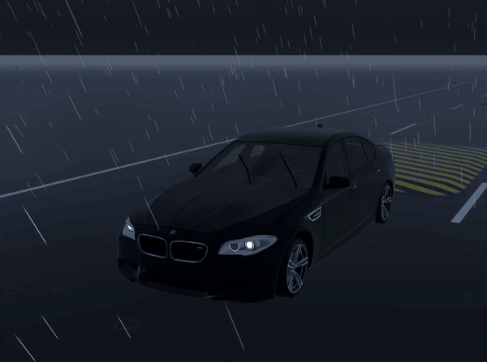

# BMW M5 F10



The current driving scene uses the imported BMW M5 F10 model in Black Sapphire Metallic (475). It includes rotating and steering wheels, independent suspension, a winding three-lane motorway with bumps, potholes and speed bumps in every lane, a branch road that splits off and rejoins, guardrails, self-driving lane keeping, a road-ahead map, working door mirrors, brake lights, a photographed daytime sky and horizon, a full day with sunset, night and dawn, weather that changes by itself, Orbit and Wireframe controls.

The road is different on every visit: its bends (lengths, directions and depth, with no radius under about 550 m), its obstacles (three or four speed bumps of different kinds, from a narrow rubber strip to a long hump or a table, and fifteen to twenty-two potholes from half a metre to 1.7 m across anywhere in the lanes, repeating only every 600 m rather than every 120 m), where the overpasses and the tunnel stand, the tunnel's length and its name follow a number drawn as the page loads. `?road=N` shows layout N again (the tests use the original layout); `?at=1900` starts that far along the road. A loading screen covers the scene until the car, road and lights are ready.

Every 3 km, after the country road, come two farm-track overpasses (a deck on three columns each side, railings, and grass embankments up to it that fall toward the motorway in a grassed slope under each end of the deck) and a tunnel of 380–620 m under a hill. The cutting narrows to the tunnel's concrete portal between wing walls; inside are light tiles, a dark vault, two lines of lamps and asphalt up to the kerbs. The sun's shadow map covers only a few metres round the car, so the road shader shades the road in a deck's shadow (where the sun puts it) and lights it by the lamps under the tunnel, daylight reaching some 30 m in from each portal. The car's body takes no shadow-map shadows (on this model its own would streak the paint), so as it passes under a deck its materials lose the sun, half the sky's light and most of the sky's reflection, in step with how much of its length is in the deck's shadow: it darkens gradually while the scene around stays in the sun. In the tunnel the car's own sun and sky light give way to the lamps, the low beams switch on in the tunnel (and their lamp on the cluster with them), and while the car or the camera is under its roof the rain is neither seen nor heard. The chase camera stays inside the tunnel's walls and under its vault. Ukrainian signs announce them, as on the E40 toward Kyiv in Kyiv Oblast: the tunnel with its name and length and a reminder to switch on the low beams, 100 and 120 km/h limits, a table of distances to Stoyanka, Kyiv and Boryspil that counts down as you drive, and the exit to Makariv, Zhytomyr and Brusyliv 500 m ahead and at the slip road, white on green for the motorway's directions and white on blue for information.

Time passes: a full day takes 24 minutes (an hour a minute), starting at 13:00. The sun rises near 7:00, stands 43° high at 13:00 as in the sky photograph and sets near 19:00. Sky, sun and moon light, skylight and fog follow it continuously: the photographed sky gives way to a sky with a warm sunset band toward the sun, golden low light and dimming fields, then twilight and a moonlit night. The low beams switch on at dusk; rear lamps, the plate light and night materials follow once it is mostly dark. In the dark the tail lamps cast a soft red glow on the road behind the car, brighter under braking (a light patch on the road rather than two more scene lights, which would add cost to every lit surface). A panel at the top centre takes the colour of the sky (blue by day, warm at sunset, deep blue at night, grey in rain). It shows the sun's path over the day with the sun or moon at the current time (click or drag it to set the time), the clock beside a glowing sun or moon with the frame rate under it (counted over half a second, its dot green from 55 fps, amber from 30, red below), a Day / Sunset / Night switch with the current phase lit, a rain button, a pause button whose ring shows how far the day has run, sound on or off, and Restart. Its sky colours are see-through, over a blurred view of the scene. On narrow screens it shows the clock and buttons at the top right. Rain sets in and eases off over about ten seconds: the drops thicken as the sky greys, the fog closes in and the asphalt darkens and starts to shine, and the rain's sound grows with it.

Low beams use a shared projected angular light profile with an upper cutoff and a raised right-hand roadside edge. Most of their 24,000 cd sits just under the cutoff, where it reaches the road 10–30 m ahead, with weaker rays toward the near road, so the road is brightest 10–15 m ahead and stays lit to about 50 m instead of a pool at the bumper. Night skylight and moonlight are low enough for the beams to stand out. The lamps remain attached to the suspended body while their aim gradually levels after pitching and rolling. Rain and road ripples sample the same projection. This is a visual approximation for right-hand traffic, guided by [HELLA's low-beam distribution reference](https://www.hella.com/techworld/en/technical/automotive-lighting/light-distribution/), rather than measured BMW photometric data.

A compact F10 M5 instrument cluster sits at the bottom right, laid out after a photograph of the European cluster: a 0–330 km/h speedometer numbered every 30 km/h with 10 km/h ticks, a 0–8 tachometer with its red zone on a semi-transparent panel, thick chrome rings, semi-bold white figures and glowing red needles. Blue information displays in the lower openings show the fuel range (from a simplified 80 L tank model), and the current M DCT gear (D1–D7) sits large between the dials. Its smoothly damped needles follow the live driving simulation. The collapsible Settings menu at the top right holds driving, weather, camera, wireframe and sound controls; Escape or clicking the scene closes it.

The suspension panel at the bottom left has a card per corner (Front left, Front right, Rear left, Rear right) with the tyre load in kN, a bar against the load at rest, and a travel gauge in mm (up is compression, down is rebound); a wheel that leaves the road is marked In the air. A dot on the car silhouette shows where the load sits, moving forward under braking and outward in a turn, and the header gives the front and left shares. Loads include static support and dynamic tyre force, and fall to zero when a wheel loses contact. These are readings from the simplified suspension model, not measured BMW telemetry. The diagram is hidden on screens narrower than 620 px so it does not cover the scene. Its readings are smoothed so they can be followed: bars and the load dot settle over about 0.15 s, the numbers over about 0.4 s and change at most five times a second, and "In the air" stays for 0.3 s instead of blinking on every crest.

Cornering uses a dynamic two-axle tyre model with lateral velocity, yaw inertia, combined braking/drive grip and suspension contact. Dry asphalt permits small slides; rain reduces grip and makes power oversteer and braking slides more pronounced. A simplified DSC controller trims drive force and applies a corrective yaw moment, allowing a slide before recovering it. The camera follows the direction of travel with a short delay so the body's sideslip remains visible. Tyre and stability-control parameters are tuned for this demo, not factory BMW calibration.

An amber skidding-car symbol (the standard one: the car with two S-shaped tracks beneath it, outline from Material Design Icons under the Apache License 2.0) flashes in the instrument cluster while DSC intervenes and extinguishes after grip returns, or when driving is paused. This follows [BMW's explanation of the flashing DSC warning](https://faq.bmwusa.com/s/article/FAQ-Dynamic-Stability-Control-BMW-FAQ-2TYkX). Normal straight cruising does not trigger it.

The standard 560 hp / 680 Nm F10 powertrain uses a seven-speed M DCT with automatic upshifts, downshifts and kickdown. The instrument cluster shows the transmission and current gear (D1–D7, or R). At a standstill, pressing S / Down again (or holding it for a second after stopping) selects reverse: S then backs the car up to 25 km/h, turning about its rear axle, and W brakes; W at a standstill selects D again. Full-throttle acceleration is calibrated to approximately 0–100 km/h in 4.4 seconds and 0–200 km/h in 13.0 seconds, with the standard electronic limit of 250 km/h, using the [original BMW launch figures](https://www.press.bmwgroup.com/global/article/detail/T0113556EN/the-new-bmw-m5?language=en). The optional 305 km/h M Driver’s Package is not enabled.

Completed gear changes produce a short, subtle camera vibration under acceleration, with a weaker impulse on braking downshifts. The effect settles in under half a second and preserves the orbit camera position and target. Pause and Restart clear it; reduced-motion preferences disable it.

Three camera views (C or the camera button in the top panel; every visit starts with the chase camera): the orbiting chase camera, the driver's seat and the bonnet. From the driver's seat, drag to look around (double-click looks ahead again); the head leads into bends and sways a little under acceleration and braking, and the overlay cluster and suspension panel give way to the car's own instruments. The model's flat door panels are replaced by F10-style door cards: a padded leather roll along the top under the window, an Aluminium Trace strip under it, the chrome opener in a dark recess, an armrest with the window and mirror switches, a pull handle, a speaker grille and a door pocket. The headliner and pillars are anthracite, and the rear-view mirror shows the road behind (its camera sits at the rear window, as the model's low cabin would otherwise fill it with the rear headrests). In the seat, sound from outside is muffled and the engine is heard through the bulkhead.

The front of the cabin is rebuilt after the F10, as the model's own dash was a few dozen flat triangles: a leather-topped dashboard in one smooth section from door to door, recessed behind the instruments under a hood with cheeks down their sides; the iDrive screen set in a recess under the dash top's brow; the centre stack turned toward the driver with two vents and the hazard switch, the radio with its CD slot, favourite keys and volume knob, the climate panel with its temperature knobs, display and keys, and a storage flap, in a gloss-black frame with chrome edges; side vents, the light switch, the glovebox's shut lines and handle; and under the lining the two sun visors, the overhead console with its map lights and the rear-view mirror on its stem, in the F10 outline (a straight lower edge, the top arched over the middle, ends leaning in) with a thin black rim. The driver's eyes sit below the windscreen's top edge, as in the car.

The M steering wheel has the F10 M's thick oval rim with tricolour stitching by the lower spoke, a domed trapezoid airbag cover, broad side spokes with key panels and pearl-chrome strips, M1 and M2 keys and the split lower spoke with the M badge. The front sport seats have deep side bolsters, a centre panel with stitched pleats and seams where it meets them; the rear bench has two sculpted outer places with the same pleats and seams either side of a raised middle. The dials sit in chrome rings in short black tubes, and the START ENGINE STOP button is right of the column. The pillars and lining are smoothed into one padded surface and catch more of the light bounced round the cabin.

The seats, headrests, rear bench, door armrests and centre armrest are in dark BMW Cognac leather with tonal stitching; all the leather (seats, dashboard, doors, console, wheel) carries a fine pebbled grain (a tileable normal map, with uvs in metres so the grain keeps its size), against the black dashboard and anthracite lining. After dusk thin amber ambient-light lines glow under the door rolls and along the dashboard's trim band. The body's painted panels have a matt black inner face, so the single-sided shell never shows the sky through gaps round the wheel arches.

The lower cabin follows the F10: the model's flat floor sheet is replaced by front footwells dropped below the seat floor (the steering wheel's rim reached through the old one), carpeted with floor mats, a toe board up to the dashboard, the M5's aluminium accelerator and brake pedals and a footrest. Between the seats runs the centre console with pearl-chrome edges, the gloss cupholder cover, the M DCT selector in an oval chrome surround, Drivelogic buttons, the iDrive controller and its keys, and the armrest. The iDrive screen sits in its recess in the dash face, the centre stack below it is about as wide as the screen, and an Aluminium Trace band with a chrome line runs across the dashboard at the height of the centre vents to the passenger side vent. The roof hides most of the sky from the cabin, so its materials take only part of the sky's indirect light (an even ambient-occlusion map), which keeps flat tops inside from glowing as if outdoors. The rear window carries its heating grid, and the parcel shelf under it is anthracite. A black undertray, the arch liners (with a band over each wheel out to the wing's skin, and unseen rings over the slit between tyre and liner on the outer side and over the gaps between the liner and the door and bumper skins) and a two-sided shadow-only plate close the car's shadow, which had gaps where sunlight passed under the sills and down past the single-sided wings round the tyres. A single-sided panel facing the sun casts nothing, so the model's cabin shell and the roof lining cast shadows too: low sun that slipped under the sills crossed the floorless cabin and left through the roof as bright streaks.

The licence plates are stamped: raised characters and rim (a normal map drawn from the same glyphs) in a black holder whose lip covers the plate's edge. In the day sky the photographed clouds drift slowly, turning as one layer above a still horizon. Taking the wheel swings the chase camera round behind the car over about a second.

Tyres smoke when they slide on dry asphalt, in a drift or with wheelspin; a fast but gripping bend makes none, wet asphalt little and loose ground dust instead. At night the high-beam assistant switches to main beam on an open road above 50 km/h (not in rain); H turns it off and on, and a blue lamp shows it on the cluster. Q and E work the turn signals: amber lamps in the headlights, door mirrors and tail lamps, green arrows on the cluster and the relay's tick; they cancel once the steering, having turned that way, comes back.

On a touch screen a steering track (bottom left) and accelerator and brake pedals (bottom right) appear. A standard gamepad also drives: left stick steers, triggers accelerate and brake, shoulder buttons signal, Y changes the camera, Start restarts and Back pauses.

Sound uses recorded V8 idle and acceleration layers, recorded rain and a tyre friction loop. Engine pitch, layer balance and volume follow RPM, load (also when cruise control accelerates), gear changes and camera distance. The engine idles at a stop or when driving is paused. Synthesised layers follow the motion: the road under each wheel (a low roll on asphalt, stones crackling on gravel, a deeper rumble on dirt, a swish through grass, nothing when the wheels leave the ground); tyre spray on a wet road; tyre squeal when the car slides on asphalt (softer in rain, none on loose ground); metal scraping along a guardrail and a clang when the car strikes one; and a thump when a wheel hits a speed bump, hump or pothole, harder the faster it is. Sound begins after the first click or keypress (the sound button in the top panel pulses until then). The sound button or M mutes it, and the choice is remembered; it also mutes while the page is hidden. The recordings are an adaptation, not stock BMW F10 audio. See [sound credits](public/assets/audio/ATTRIBUTION.md).

Hard braking and strong lateral tyre scrub leave soft-edged deposits on dry asphalt, with much lighter traces in rain. Each trail follows wheel position, contact and load, with gaps over road obstacles and holes. Marks stay in world space and fade after 35–65 seconds; Restart clears them. One GPU-instanced draw uses a fixed buffer of 8,192 segments. Deposits are a visual effect driven by deceleration and axle slip angles; individual wheel spin and ABS cycling are not simulated.

Brake pressure builds to full effort over 0.4 seconds while S / Down is held and releases immediately on key-up. Short taps and low-speed stops leave clean asphalt. Braking deposits require at least 88% pedal effort, speed above 45 km/h and deceleration above 8.8 m/s² on dry asphalt (4.8 m/s² in rain, where grip and deposits are weaker); light braking while turning cannot bypass those thresholds.

The car feels what it drives on. Each wheel reads its own surface: asphalt on the carriageway and its shoulders, gravel strips beside the motorway, packed dirt on the country road and grass in the fields. Grip is averaged over the four wheels, so two wheels on the gravel pull at the car: gravel and dirt grip about two thirds as well as dry asphalt and grass half, and in rain dirt turns to slippery mud. Loose and soft ground adds rolling drag (three to five times asphalt's), so the car accelerates slower and tops out lower there, and its bumps, a couple of centimetres high and one to four metres long, work the suspension. The bumps are felt rather than drawn: the body rides them while the wheels are drawn on the visible ground, and black wheel-arch liners (missing in the model) fill the arches, so a drooping wheel no longer shows the grass through the body. Off the asphalt the rear wheels raise dust that hangs in the car's wake and thins out: a thick pale trail on dry dirt, less on gravel, a light haze on grass and none on wet ground. The car gets dirty too: dry ground coats it in dust, thickest on the sills, bumpers and lower doors and behind the wheels, lighter on the tail and a faint film on top; wet ground throws mud blotches and speckles behind the wheels and along the sills, pale brown as it dries and dark and glossy while wet. Dirt dulls the clear coat. Rain washes dust off within a minute or so and mud more slowly; Restart brings back a clean car.

Engine ratings, gear ratios, mass, drag and tyre dimensions follow [BMW technical data](https://www.ausmotive.com/downloads/BMW/M5-press-kit-Feb2012.pdf). Drivetrain losses, launch grip, clutch transitions and automatic shift strategy are simplified model assumptions calibrated to the launch figures for ideal dry conditions. The demo starts driving on page load; the self-driving cruise control picks up 90 km/h, eases off for bends and slows to 50 km/h over each speed bump. After using the accelerator or brake, releasing the pedals lets it coast.

Light exhaust vapor exits all four tailpipes, rises and disperses in the car's wake, and increases under acceleration. Vapour and wheel dust that drift alongside the body fade out, so the soft camera-facing puffs never show through the wheel arches or cut across the bodywork. Pause freezes the plume; Restart clears it.

Rain is independent of Night. With Weather changes on (the default), dry spells of 2.5–5 minutes alternate with 1–2.5-minute showers whose drops set in and ease off over 8 seconds; switching Rain by hand keeps that weather for a full spell. Rain adds falling drops, road ripples, overcast lighting, shorter visibility and a wet reflective asphalt surface at any time of day.

The wet asphalt retains diffuse headlight illumination, with a varied water film and rougher aggregate between smoother patches. Its reflections remain directional without a uniform mirror-like coating. The small surface mask is fixed in world space and uploaded once; changing weather or recentering the road does not animate or rebuild it.

Per frame the scene draws about 0.65 million triangles in some 370 draw calls in the chase view. The cabin's parts (seats, door cards, wheel) receive the body's shadow but cast none, which keeps them out of the shadow map. The rear-view mirror renders only from the driver's seat, and the door mirrors update every fourth frame each in the chase view (every other frame from the seat). Materials that first appear later (the mirror, turn signals, dust and smoke) are compiled while the scene loads, and the high beam's pattern is made and uploaded then too. The road's bumps are evaluated only within 60 m of the car, from three samples per vertex; grass and gravel are sampled only off the asphalt and parallax only within 25 m. The two door mirrors update on alternate frames, so together they add one scene render per frame. Lamps switch by intensity and wet asphalt is rebuilt only when the rain changes, so dusk and dawn cause no shader recompiles. Falling rain and ripples use two GPU-instanced draws, with no per-drop CPU animation or per-frame particle-buffer uploads. Wiper shapes are fitted to the windshield once and interpolated during playback. Rendering starts within a three-million-pixel Retina budget (the road's shading, the costliest per pixel, grew faster than the pixel count: about 5 ms of GPU time at 1.8 million pixels, 15 ms at 3.1 million) and lowers canvas resolution once frames run below about 54 fps, while keeping the interface sharp and retaining all particles and suspension updates. The road shader tests each bump and pothole with a subtraction and a comparison before working out its shape, and takes the nearest overpasses' places as uniforms rather than working out the road's curve per pixel. Off the asphalt (the verges and fields, much of the screen) the road shader reads none of the asphalt's photographs and works out no parallax, gravel is read only on the verge and the country road, and the asphalt's roughness and occlusion come from one lookup. By day the headlamps' two projected lights are out of the scene's lights, so no pixel works them out; the programs with them in are compiled in the background after loading, so dusk or the tunnel switches without a hitch. The cabin's still parts are joined into one mesh per material (some 225 meshes into 85) on a layer of their own, which the mirrors' cameras and the sun's shadow pass skip; drawing a frame took about half the CPU time it did. The cluster's needles turn on layers of their own, so the scales, their glow and shadow are not repainted every frame; the cabin's screens are redrawn only from the driver's seat; and the sky's reflection is refreshed every 1.5 s rather than twice a second.

In clear daylight the sky is a photograph: Poly Haven's CC0 panorama "Sunflowers" from the zenith to 6° below the horizon, shown at 4096 × 1092 and reflected in the paint and glass, with the sun light aligned to the photographed sun (43° elevation). Its lower edge is the real horizon, a sunflower field and tree lines, into which the ground fades through matched fog. Night and rain keep the procedural sky with drifting clouds; its reflections refresh twice a second through a persistent capture cube and reusable filtered targets, and between refreshes the reflection turns with the cloud drift, so reflected clouds glide smoothly instead of jumping. The sky renders after opaque surfaces so its cloud shader avoids pixels covered by the car or road. Water and exhaust update only the body transforms they need. Tyre trails discard distant segments before evaluating the road profile and upload only changed slots in their fixed buffer.

The road runs through open country. The asphalt is a photographed CC0 surface (Poly Haven "Asphalt Track", weathered to a lighter grey) with a normal map for its stones and pores, roughness and occlusion maps, and parallax from its height map within 25 m, so the aggregate keeps its depth as the view moves; rain halves the relief as water fills the pores. The normal map is high-pass filtered: its broad tilts, invisible by day, showed as bands across the road under the grazing low beams. Over it lie polished wheel tracks in each lane, softly edged repair patches, sealed cracks and unevenly worn paint. A gravel shoulder and photographed grass (Poly Haven "Rocks Ground 02" and "Leafy Grass", each tiled at two scales and orientations with broad patches of colour) border it. Speed bumps and holes keep their colour at any distance and rise smoothly into relief within 60 m; their yellow-black stripes are filtered by their size on screen, so distant bumps do not shimmer.

The road winds: three bends of unrelated lengths add up to long sweepers, tighter bends down to a radius of about 550 m and near-straights, never repeating exactly. The drive opens with a 550 m bend that turns the road 12° within 200 m. Lanes, paint, verges, guardrails and every obstacle follow it. Each lane has its own potholes and bumps in the wheel tracks, and two speed bumps span all three lanes. From 300 m, and then every 3 km, an unpaved country road leaves the right lane, swings out 42 m behind a strip of grass and rejoins it after 600 m: packed dirt and gravel with two wheel ruts, grass on the hump between them and at its edges, no paint and no guardrails, so the car can leave it for the fields. The main road's right edge line is dashed across its mouths. Any lane or the country road can be driven.

After the page loads and after Restart the car drives itself and keeps its lane: a controller combines the path's curvature (scaled for understeer at speed), the heading and lateral error and yaw damping. A curve speed limit (4 m/s² of lateral grip, slowing early at 2 m/s²) lets it hold within about 1.5 m of the lane centre at full throttle over every bump, dry or wet. A hint under the top panel says how to take over while it drives itself. Pressing any driving key (or touching the wheel or pedals, or a gamepad) hands over full manual control with no steering assistance until Restart; driving keys work wherever the focus is, also right after clicking a button.

Galvanised W-beam guardrails line both sides of the main road (`guardrailsEnabled` in `public/road-profile.js` removes them all): zinc spangle, splice bolts, C-channel posts and spacer blocks every 4 m, four different panel textures and dirtier or cleaner stretches along the road, drawn 700 m ahead and behind. The right rail opens for about 110 m where the country road leaves and rejoins; beside the country road it can be hit from either side, so a car crossing the field from the country road cannot pass through it. Rails are solid from both sides, so they also stop a car coming from the field. Corners of the body that reach a rail push the car back, its speed into the rail is absorbed with a small rebound, the rail scrapes speed off along its length and the car swings parallel to it, while white-hot sparks stream from the contact, cooling to orange and red. Every contact leaves scratches where it rubs: a band at the beam's height on the side that touched, long thin streaks along the car through the clear coat to grey primer and bare metal, deeper the harder and longer the scrape. How much of the side is marked follows the car's angle to the rail: a glancing hit marks the corner, rubbing along it parallel marks the whole side. They stay until Restart.

A road-ahead map in the top left shows the next 1.5 km with sideways deviation magnified, so curves and the car's place in its lane read at a glance, with the branch road, speed bumps, the recent path and the direction and distance of the next curve. The door mirrors work like real convex door mirrors: the model's chrome glass is replaced by flat glass of the same outline showing a live 42° rear view from a camera at each mirror, turned slightly outward, so they show the lanes behind and a sliver of the car's flank from any viewing position.

A soft contact shadow with darker tyre patches keeps the car on the ground. Khronos PBR Neutral tone mapping keeps the black paint deep and colours true, and a longer 34° lens with proportionally farther camera gives photographic proportions. The paint has fine metallic flakes under a mirror-smooth clear coat, fading out where they would shimmer; tyres are matte, deep grey rubber and the wheels machined alloy.

Water beads accumulate on painted panels and remain after the rain stops. Gravity drains them slowly; airflow stretches and moves them rearward as speed increases. The paint gradually returns to its dry finish.

The windshield, rear window and side glass also collect beads and longer running drops. Their flow follows the slope of each pane and changes with vehicle speed, while retaining glass transparency.

Rain automatically runs two modeled front wipers. The flexible 650/450 mm blades follow the imported windshield and clear only the areas they sweep; drops gradually collect there again. Switching Rain off lets them finish the cycle and park. The layout follows the [M5 F10 parts diagram](https://www.bmwpartsdeal.com/parts-list/2013-bmw-m5-sedan_f10/vehicle_electrical_system/single_wiper_parts.html), with blade lengths from the [Bosch application catalogue](https://images-na.ssl-images-amazon.com/images/I/91S3otAdGGS.pdf). Pivot positions and stroke are fitted to this visual model, rather than factory CAD coordinates.

The seats and the steering wheel are modelled for this demo, replacing the downloaded model's coarse ones (a few dozen flat triangles per seat). The front seats are sculpted sports seats in black Merino-style leather: smooth cushion and backrest lofted through cross-sections, with raised side bolsters, a darker perforated centre panel and separate headrests on chrome posts. The rear bench matches them, with two outer seats, a raised centre and three headrests (the middle one smaller). All of them sit on the model's own cabin floor, which is high and low-roofed, so they keep its compressed proportions; the front seats stand 15 cm ahead of the model's, at the B-pillar, and a dark carpet covers the floor sheet whose light texture showed through the windows. The wheel is the three-spoke M leather wheel, fitted to the model's own wheel position: a thick rim with thumb rests, the airbag pad with the BMW roundel, side spokes with button panels and a chrome strip, the split lower spoke with the M badge, and shift paddles. It turns with the steering at a 14:1 ratio. The cluster behind it, a blurred picture in the model, is a sharp live display in the style of the European cluster: 0–330 km/h and 0–8000 rpm dials with the red zone, orange needles, the speed and the gear, redrawn 15 times a second. The model's blurred portrait picture in the centre of the dashboard is replaced by the F10 layout: a wide 8:3 iDrive screen standing on the dashboard in a black bezel, showing a live heading-up navigation map of the road ahead (the route in blue, the country roads in brown) beside the time of day, the outside temperature and the radio, and below it the centre stack with two vents, the hazard switch and the climate panel.

The wheels drop into potholes and ride over bumps in the physics, but the springs and dampers soak up nearly all of a sharp edge: the tyre's load doubles for a few hundredths of a second while the body moves only millimetres. So a wheel's sudden load (against its slowly changing load, so braking, cornering and swells do not count) also kicks soft springs: the body dips toward that wheel and settles in a short sway, and the camera eases down and back without a bounce, harder the faster the car goes, front wheels and then rear. Potholes have an irregular outline of their own, steep broken sides and an uneven floor (the same shape for the wheels and on screen); their bed shows the stones under the asphalt, their rim crumbles in patches, and in rain they hold puddles.

Front and rear Ukrainian registration plates read AP 1860 EA: the standard 520 × 112 mm format with the blue UA band and flag. Their characters are drawn as bold vector shapes with proportions measured from a real plate, not a system font. Each plate is fitted to the body by ray casting, follows the local tilt of the bumper or boot lid, and replaces the model's blank US-size rear plate. The rear plate is lit at night.

The stock M Compound brakes have drilled, internally vented iron discs, separate aluminium hats and blue M calipers (six-piston fixed front, single-piston floating rear). Nominal diameters are 400/396 mm; the assemblies are fitted proportionally to the imported wheels. References: [BMW brake-system description](https://www.press.bmwgroup.com/canada/article/detail/T0135232EN/text.html?actionType=copyToClient&comingFrom=transferOverview&id=165340), [front parts diagram](https://www.realoem.com/bmw/enUS/showparts?diagId=34_1423&id=FV91-EUR---F10-BMW-M5), [rear parts diagram](https://www.realoem.com/bmw/enUS/showparts?diagId=34_1472&id=FV91-EUR---F10-BMW-M5). Caliper contours and drilling patterns are visual reconstructions.

Brake work heats the iron friction rings gradually, progressing from dark red to orange under sustained heavy braking: a full stop from about 200 km/h starts a dull red glow (from 330 °C), one from 250 km/h or repeated hard stops turn it orange; ordinary stops stay metallic. A simplified surface/core heat model accounts for front/rear energy distribution, retained heat, airflow, radiation and faster cooling in rain. Its temperatures and glow are illustrative, not BMW test measurements. Calipers and aluminium hats do not glow. Restart cools the brakes; parked or paused cars cool naturally without adding brake heat.

## Run

Install Node.js 20 or later. From this folder, run:

```sh
npm ci --ignore-scripts
npm start
```

Open http://127.0.0.1:52259/ in a browser. Keep the server running while using the viewer.

For another available port, use `npm start -- --port 0` and open the printed address.

## Controls

- Settings: open or collapse the controls at the top right.
- Sound / Volume: enable or mute audio and adjust its level.
- Drive / Pause or Space: start and pause driving. Leaving the tab pauses it; coming back drives on.
- C or the camera button (top panel): chase, driver's seat or bonnet view.
- Q / E: left / right turn signal. H: high-beam assistant off or on.
- M or the sound button (top panel): mute or unmute.
- R or the restart button (top panel): restart. The Settings panel is hidden for now (remove `hidden` from it in `public/index.html`).
- W / Up: accelerate; S / Down: brake.
- A / Left and D / Right: steer. Until the first driving key after loading or Restart, the car drives itself and keeps its lane.
- Restart: reset the car and route.
- Orbit: move the camera around the car.
- Time panel (top centre): set the time on the sun graph, jump to Day, Sunset or Night, toggle rain, pause or resume time.
- Night: jump to 23:00 (unchecked: 13:00).
- Rain: toggle rain independently of Night.
- Weather changes: rain starts and stops by itself (on by default).
- Wireframe: show the mesh.
- Drag and scroll on the scene: orbit manually and zoom.
- For a close inspection of the front brake, open `http://127.0.0.1:52259/?detail=brakes&paused=1`; the normal URL retains the general view.

## Files

- `public/index.html` and `public/viewer.js`: the current interface and scene.
- `public/instruments.js` and `interface.css`: animated F10-style instruments and the collapsible settings menu.
- `public/suspension-display.js`: live four-corner tyre load, spring and damper diagram.
- `public/shift-shake.js`: bounded camera impulses on completed gear changes.
- `public/dashboard.js`: the dashboard, instrument hood, centre stack, sun visors and overhead console.
- `public/cabin-floor.js`: footwells, pedals and the centre console.
- `public/camera-views.js`, `door-trim.js`, `signals.js`, `tyre-smoke.js` and `touch-controls.js`: camera views and the driver's head, door cards, turn signals and high beam, tyre smoke, touch and gamepad driving.
- `public/vehicle-audio.js` and `public/assets/audio/`: RPM-driven recording playback, synthesised road, squeal, scrape and knock sounds, and sound attribution.
- `public/skid-marks.js`: contact-aware, bounded instanced tyre trails under hard braking.
- `public/vehicle-rig.js`, `driving-physics.js`, `brake-lights.js` and `headlights.js`: wheel rig, driving and lights.
- `public/road-profile.js`: road centre line, lanes, branch road, obstacles, guardrail layout and the straight test track used by vehicle tests.
- `public/lane-keeping.js`, `sparks.js`, `minimap.js` and `mirrors.js`: lane keeping and curve speed, guardrail sparks, the road-ahead map and rear-view door mirrors.
- `public/weather-cycle.js`: rain that comes and goes by itself.
- `public/dust.js` and `body-dirt.js`: dust from the wheels off the asphalt, and dust and mud on the paint.
- `public/tyre-dynamics.js`: dry/wet axle grip, lateral motion and simplified DSC intervention.
- `public/headlight-profile.js`: the shared projected low-beam distribution.
- `public/powertrain.js`: standard F10 engine, seven-speed M DCT and speed limiter.
- `public/brakes.js` and `brake-heat.js`: modeled M Compound brakes and energy-driven rotor heat.
- `public/license-plates.js`: Ukrainian registration plates, drawn and fitted at runtime.
- `public/environment.js`, `road.js`, `road-profile.js` and `rain.js`: sky, weather, asphalt and tyre contact surface.
- `public/interior.js`, `cockpit-cluster.js` and `centre-display.js`: the new seats, M steering wheel, live instrument cluster, iDrive screen and centre stack in the car.
- `public/time-of-day.js` and `day-bar.js`: the sun over the day, the light, sky and fog it gives, and the time panel.
- `public/roadside.js`: guardrails, posts and spacers along the road, the branch and the gore (the verges are drawn in `road.js`).
- `public/contact-shadow.js` and `car-materials.js`: ground contact shadow, paint flakes and wheel materials.
- `public/assets/sky/sky-day.jpg`: clear-day sky photograph (see `public/assets/ATTRIBUTION.md`).
- `public/body-water.js` and `wipers.js`: surface drops, automatic front wipers and their synchronized clearing mask.
- `public/render-quality.js`: bounded Retina resolution and gradual adaptation to sustained frame load.
- `public/assets/bmw-m5-f10.glb`: the only car asset.
- `public/assets/ATTRIBUTION.md`: model author, source, license and adaptations.
- `tools/serve.mjs`: local server.
- `tests/`: geometry, suspension, steering, lights, exhaust and weather checks (`npm test`).

The GLB remains unmodified; scale, paint and moving parts are adapted at runtime. This is an unofficial visual prototype.

## Public demo build

Run `npm ci --ignore-scripts` and `npm run build` to create a standalone static demo in `dist/`. Publish that folder under any path, including `/bmw-driver/`. Its application JavaScript is bundled and obfuscated with a fixed seed; third-party rendering modules remain minified. The build ships no source maps or readable application modules, and retains model attribution and library licensing. This is code obfuscation, not secrecy: the public source repository remains readable.

Use `?capture=1&paused=1` for a clean screenshot without the overlay. The normal URL keeps all controls and telemetry visible.

## Code formatting

Run `npm run format` to format the source, or `npm run format:check` to check it. The pinned formatter uses `.prettierrc.json` and is cached outside the project.
